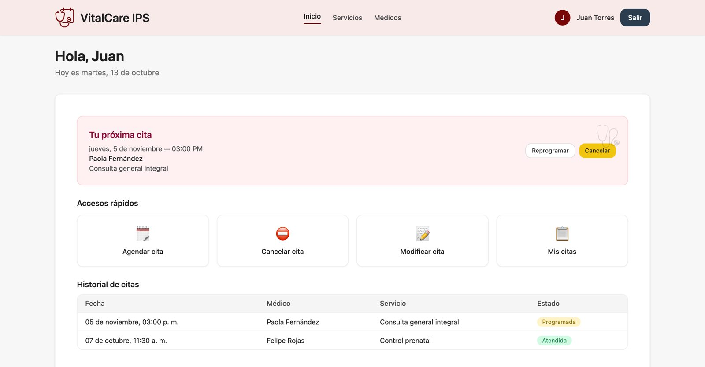
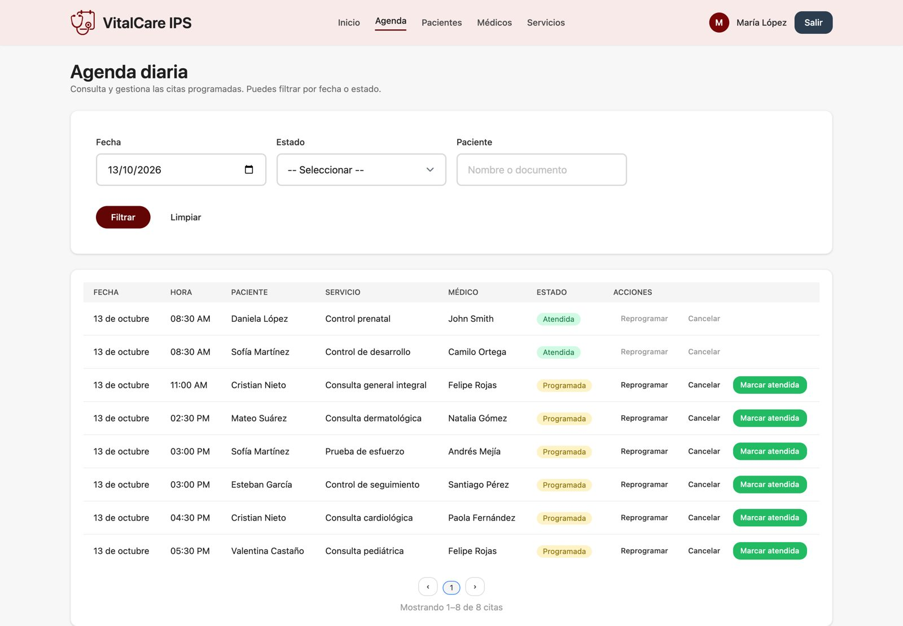
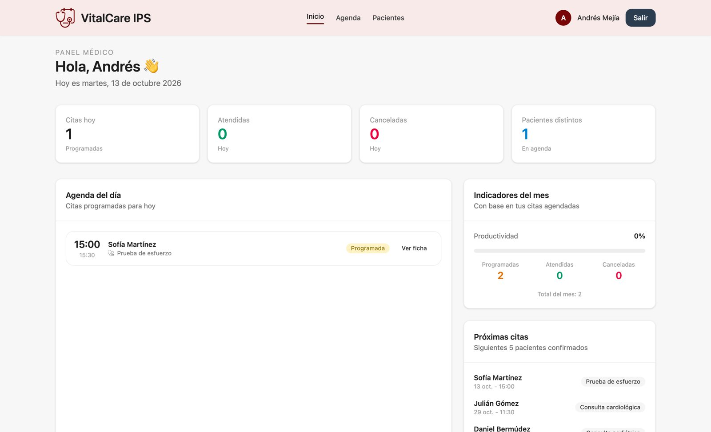
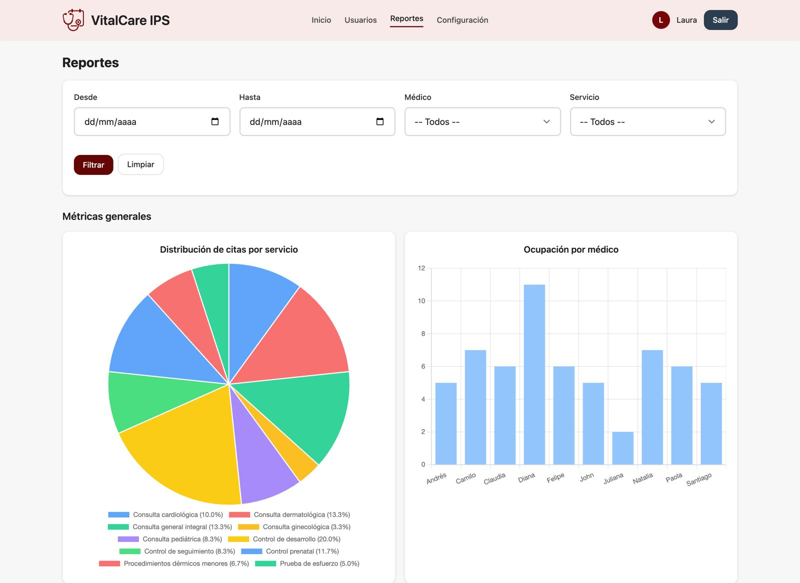

# Oris

Aplicación web en **PHP y Laravel** para gestionar una IPS (institución prestadora de salud): agendamiento de citas médicas, agendas de médicos, gestión de pacientes y usuarios, y reportes para la administración. Busca resolver un problema real de varias IPS de Bucaramanga: centralizar y digitalizar la gestión de citas y usuarios.

La aplicación tiene cuatro portales, uno por rol:

- **Paciente:** entra sin contraseña, con su documento y un enlace que le llega al correo. Agenda, reprograma y cancela sus citas, y consulta médicos y servicios.
- **Secretaría:** agenda diaria con filtros, registro de pacientes, agendamiento, reprogramación y cancelación de citas, y bloqueo de horarios de los médicos.
- **Médico:** panel con las citas del día, indicadores del mes, agenda personal y lista de sus pacientes.
- **Administración:** usuarios y roles, especialidades y servicios, y reportes con gráficos de ocupación.



**English summary:** Laravel web app for managing a Colombian outpatient clinic: patients book and manage appointments through a passwordless magic-link login, front-desk staff manage the daily schedule, doctors see their agenda and monthly metrics, and admins manage users and see occupancy reports. Built by a team of two with role-based access, slot-availability rules, automated email reminders and feature tests running on GitHub Actions.

## Capturas

**Secretaría, agenda del día:**



**Médico, panel de inicio:**



**Administración, reportes:**



## Reglas de negocio que cuida la aplicación

- Solo se agenda dentro del horario de la clínica (8:00 a 12:00 y 14:00 a 18:00, en bloques de 30 minutos) y dentro del próximo mes.
- No se puede agendar en el pasado ni poner dos citas al mismo médico a la misma hora.
- Los horarios bloqueados por la secretaría y la disponibilidad de cada médico se respetan al agendar y al reprogramar.
- Una cita cancelada o atendida no se puede reprogramar ni volver a cancelar.
- Cada rol solo puede entrar a su portal, y un usuario inactivo no puede iniciar sesión.
- Los pacientes con citas en las próximas 72 horas reciben un recordatorio por correo.

## Tecnologías

PHP 8.2+, Laravel 12, Blade, Tailwind CSS, Vite, Eloquent, MySQL o SQLite, PHPUnit, GitHub Actions, Mailtrap para correos de prueba.

## Cómo ejecutarlo

Requisitos: PHP 8.2 o superior, Composer y Node.js.

```bash
git clone https://github.com/jgesc-05/oris.git
cd oris
composer install
npm install
npm run build
cp .env.example .env
php artisan key:generate
touch database/database.sqlite
php artisan migrate:fresh --seed
php artisan serve
```

Con esto la app corre en http://127.0.0.1:8000 con SQLite y datos de ejemplo: médicos, pacientes y citas alrededor de la fecha actual.

**Usuarios de prueba** (contraseña `12345678`):

- Administración: `laura.administradora@vitalcare.com`
- Secretaría: `maria.secretaria@vitalcare.com`
- Médico: `andres.mejia@vitalcare.com`
- Paciente: en `/paciente/login`, con cédula `1105001001` y fecha de nacimiento `11/04/1992`. Con `MAIL_MAILER=log` el enlace de acceso queda escrito en `storage/logs/laravel.log`.

### Usar MySQL en lugar de SQLite

Crea una base de datos llamada `oris_db` y cambia en el `.env`:

    DB_CONNECTION=mysql
    DB_HOST=127.0.0.1
    DB_PORT=3306
    DB_DATABASE=oris_db
    DB_USERNAME=root

### Correos con Mailtrap

Para ver los correos reales (enlace de acceso y recordatorios), crea una cuenta en [Mailtrap](https://mailtrap.io) y pon sus credenciales SMTP en el `.env`:

    MAIL_MAILER=smtp
    MAIL_HOST=smtp.mailtrap.io
    MAIL_PORT=25
    MAIL_USERNAME=tu_usuario_mailtrap
    MAIL_PASSWORD=tu_password_mailtrap

Los recordatorios de citas en las próximas 72 horas se envían con:

```bash
php artisan citas:loop
```

## Pruebas

```bash
php artisan test
```

Las pruebas cubren el acceso por rol (inicio de sesión, usuarios inactivos, permisos entre portales) y las reglas de agendamiento (horario libre, fechas pasadas, citas duplicadas y horario de la clínica). Corren automáticamente en GitHub Actions con cada push.

## Estructura

- `app/Http/Controllers/`: controladores por portal (`Secretary/`, `Auth/`, médico, paciente y administración)
- `app/Services/AppointmentAvailabilityService.php`: reglas de disponibilidad de horarios
- `app/Http/Middleware/EnsureRole.php`: control de acceso por rol
- `database/migrations/` y `database/seeders/`: modelo de datos y datos de ejemplo
- `resources/views/`: vistas Blade de cada portal
- `tests/Feature/`: pruebas de acceso y agendamiento

## Equipo

Proyecto hecho en pareja, con trabajo en ramas y pull requests.

- **Leydy Macareo:** portal de la secretaría (agenda diaria, gestión de pacientes, agendar, reprogramar y cancelar citas, bloqueo de horarios), portal del médico (panel, agenda y pacientes), inicio de sesión de pacientes y sus pantallas de citas, datos de ejemplo y diseño responsive.
- **Juan Guillermo Escobar:** portal de administración (usuarios, especialidades, servicios y médicos), reportes con gráficos, recordatorios por correo, vistas de médicos y servicios conectadas a la base de datos, paginación y validaciones de formularios.
